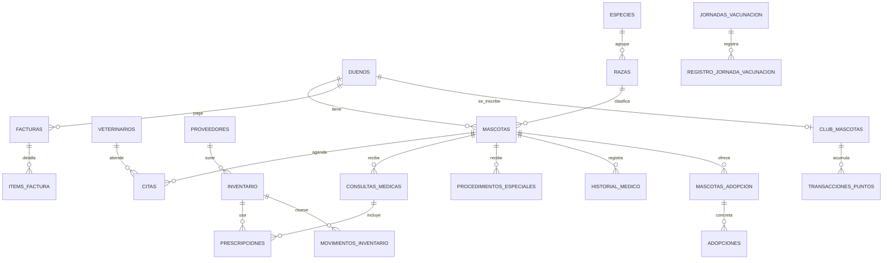

# Sistema de Gestión Integral para la Veterinaria "Happy Feet"

Aplicación de consola en Java para administrar una clínica veterinaria: pacientes, citas y consultas, inventario, facturación y actividades especiales.

## Descripción del contexto

La clínica "Happy Feet" llevaba toda su operación en fichas de papel, agendas y hojas de cálculo, y eso le causaba problemas todos los días:

- **Historiales incompletos:** encontrar las vacunas o alergias de una mascota en una emergencia era lento.
- **Fugas de inventario:** no había control del stock de medicamentos en tiempo real.
- **Agenda caótica:** las citas se cruzaban y los dueños esperaban demasiado.
- **Facturación lenta y con errores:** se calculaba a mano, incluyendo insumos y medicamentos.

Este sistema centraliza todo: desde la ficha del paciente hasta la factura.

## Tecnologías utilizadas

- Java 17 (JDK 17 o superior)
- MySQL 8
- JDBC (driver `mysql-connector-j`)
- Maven
- Programación funcional: expresiones lambda y API Stream
- Probado para abrirse con Apache NetBeans (proyecto Maven)

## Arquitectura

Se usa el modelo **MVC** con una capa de repositorios para el acceso a datos:

```
src/main/java/com/happyfeet
├── Main.java                 Punto de entrada
├── controller/               Controladores (flujo de la aplicación)
├── model/entities/           Entidades (records) que mapean las tablas
├── model/enums/              Enumeraciones (estados, tipos, niveles)
├── repository/               Interfaces de acceso a datos
│   └── jdbc/                 Implementaciones con JDBC
├── service/                  Lógica de negocio
│   └── descuento/            Estrategias de descuento
├── view/                     Vistas de consola
├── exception/                Excepciones propias
└── util/                     Conexión, logger, formatos
```

**Principios SOLID:** cada clase tiene una responsabilidad (por ejemplo `FacturaBuilder` solo arma facturas), los servicios dependen de interfaces de repositorio y no de JDBC (inversión de dependencias), y se pueden agregar nuevos descuentos sin tocar la facturación (abierto/cerrado).

**Patrones de diseño usados:**

| Patrón | Dónde |
|---|---|
| Singleton | `DatabaseConnection`, `AppLogger` |
| Factory | `ControladorFactory`, `DescuentoStrategyFactory` |
| Strategy | `DescuentoStrategy` (descuento según nivel del club) |
| Builder | `FacturaBuilder` |
| Observer | `AlertaInventarioListener` (la vista y el log reciben las alertas de inventario) |
| Template Method | `ControladorBase` (ciclo común de los menús) |
| Repository | interfaces en `repository/` + implementaciones JDBC |

**Manejo de errores:** hay excepciones propias (`ReglaNegocioException`, `StockInsuficienteException`, `ProductoVencidoException`, `AccesoDatosException`). Los errores se muestran de forma amigable y se guardan en el archivo `happyfeet.log` en la carpeta principal del proyecto.

## Funcionalidades implementadas

### 1. Gestión de pacientes
- Registro de dueños (correo y documento únicos, contacto de emergencia opcional).
- Registro de mascotas con datos básicos, microchip, tatuaje, foto (URL), alergias y condiciones preexistentes. Si no se sabe la fecha de nacimiento se usa una edad estimada.
- Cada mascota tiene un único dueño y se puede **transferir** a otro.
- Ficha de la mascota con historial médico, historial de vacunas y cirugías previas.

### 2. Servicios médicos y citas
- Agenda de citas con estados (Programada, Confirmada, En Proceso, Finalizada, Cancelada, No Asistió).
- **Regla:** no se pueden cruzar citas del mismo veterinario o de la misma mascota (bloques de 30 min) y la clínica atiende de 8:00 a 18:00.
- Consultas médicas con diagnóstico, recomendaciones y prescripción de medicamentos.
- Procedimientos especiales (cirugías) con información preoperatoria, detalle, insumos y seguimiento postoperatorio.
- **Regla clave:** al prescribir un medicamento o usar un insumo, el stock se descuenta automáticamente, todo en una transacción (si algo falla no se guarda nada).

### 3. Inventario y farmacia
- Control de stock de medicamentos, vacunas, insumos, alimento y accesorios.
- Alertas de stock bajo, productos por vencer (30 días) y vencidos; se muestran al iniciar el sistema.
- **Regla:** no se puede usar un medicamento o vacuna vencido.
- Entradas de stock (reabastecimiento), historial de movimientos y registro de proveedores.

### 4. Facturación y reportes
- Factura en texto plano de una consulta, un procedimiento o una venta directa, con subtotal, descuento, IVA (19 %) y total. Se guarda también en `facturas/NUMERO.txt`.
- Reportes en consola: servicios más solicitados, desempeño del equipo veterinario, estado del inventario y facturación por período.

### 5. Actividades especiales
- **Días de adopción:** registro de mascotas disponibles y contrato de adopción en texto (la mascota pasa al adoptante).
- **Jornadas de vacunación:** registro rápido y masivo (se elige la vacuna una vez y luego solo se escriben ids de mascotas), con control de capacidad y descuento de inventario.
- **Club de Mascotas Frecuentes:** 1 punto por cada $1.000 pagados, niveles Bronce / Plata / Oro / Platino (descuento de 0 %, 5 %, 10 % y 15 % en las facturas) y canje de beneficios.

## Modelo de la base de datos

El script completo está en `database/schema.sql`. Resumen:

- **Tablas de consulta:** `especies`, `razas`, `producto_tipos`, `evento_tipos`, `cita_estados`.
- **Pacientes:** `duenos` (1) — (N) `mascotas`.
- **Servicios médicos:** `veterinarios`, `citas`, `consultas_medicas`, `procedimientos_especiales`, `historial_medico`.
- **Inventario:** `proveedores`, `inventario`, `prescripciones`, `insumos_procedimientos`, `movimientos_inventario`.
- **Facturación:** `servicios`, `facturas` (1) — (N) `items_factura`.
- **Actividades:** `mascotas_adopcion`, `adopciones`, `jornadas_vacunacion`, `registro_jornada_vacunacion`, `club_mascotas`, `transacciones_puntos`, `beneficios_club`, `canjes_beneficios`.



**Decisión de diseño:** las mascotas en adopción se guardan a nombre de un "dueño" especial (id 1: *Clínica Happy Feet (Refugio)*), y al adoptar se transfieren al adoptante.

## Instrucciones de instalación y ejecución

### Requisitos previos
- JDK 17 o superior
- Maven 3.8 o superior (NetBeans ya trae uno integrado)
- MySQL Server 8.0.16 o superior (por los `CHECK`)

### Clonación
```bash
git clone https://github.com/LeZuni/proyecto-happy-feet.git
cd proyecto-happy-feet
```

### Configuración de la base de datos
Abre `src/main/resources/db.properties` y cambia los datos de tu MySQL:

```properties
db.url=jdbc:mysql://localhost:3306/happy_feet_veterinaria?useSSL=false&allowPublicKeyRetrieval=true&serverTimezone=America/Guatemala
db.user=root
db.password=TU_CONTRASEÑA
```

También puedes dejar la contraseña vacía en el archivo y usar la variable de entorno `HAPPYFEET_DB_PASSWORD`.

### Ejecución de scripts
Ejecuta **en este orden** (el primero borra y vuelve a crear la base `happy_feet_veterinaria`):

```bash
mysql -u root -p --default-character-set=utf8mb4 < database/schema.sql
mysql -u root -p --default-character-set=utf8mb4 < database/data.sql
```

(También puedes abrirlos y ejecutarlos desde MySQL Workbench.)

### Ejecución del proyecto
```bash
mvn compile exec:java
```

En NetBeans: *File > Open Project*, selecciona la carpeta del proyecto y presiona *Run* (F6).

## Guía de uso

Al iniciar se muestran las alertas del inventario y el **menú principal**:

1. **Gestión de pacientes:** registrar dueños y mascotas, ver la ficha con el historial, transferir una mascota, actualizar el peso.
2. **Servicios médicos y citas:** agendar citas, cambiar su estado, registrar consultas (con prescripciones) y procedimientos, ver el equipo veterinario.
3. **Inventario y farmacia:** ver el stock, registrar productos, reabastecer, ver alertas y gestionar proveedores.
4. **Facturación y reportes:** facturar consultas, procedimientos o ventas, ver facturas en texto y los 4 reportes gerenciales.
5. **Actividades especiales:** adopciones, jornadas de vacunación y club de mascotas frecuentes.

En cada menú se elige un número y `0` sirve para volver. Las fechas se escriben como `dd/MM/yyyy` y las horas como `HH:mm`.

Datos de prueba útiles: la jornada de vacunación "Jornada antirrábica del mes" ya está *En Curso* para probar el registro rápido; los dueños 2, 3 y 4 ya están en el club; el producto "Vacuna Bordetella" está vencido para probar la restricción.

## Autor(es)

- LeZuni
